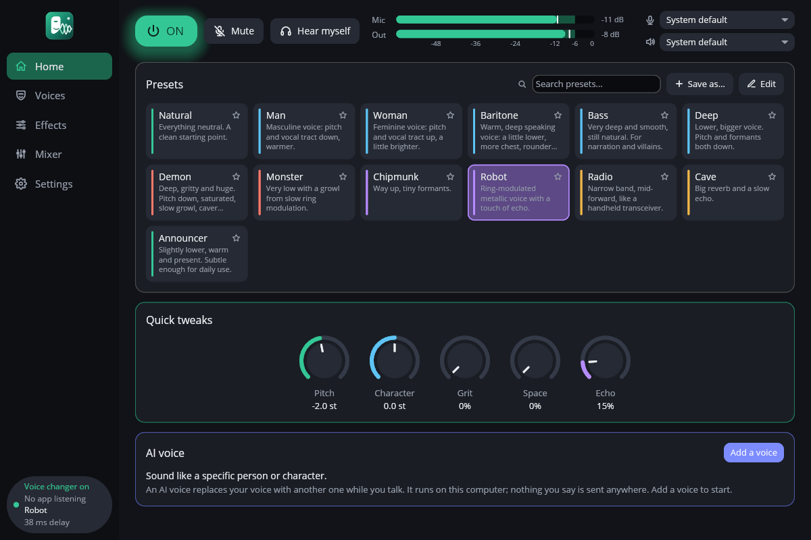
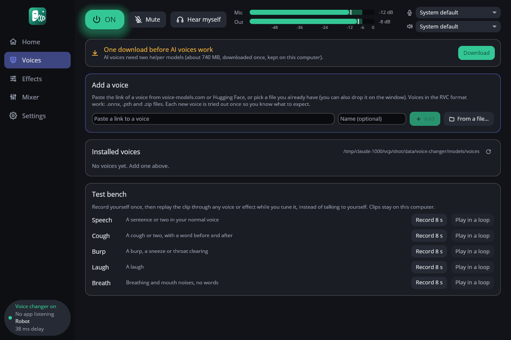
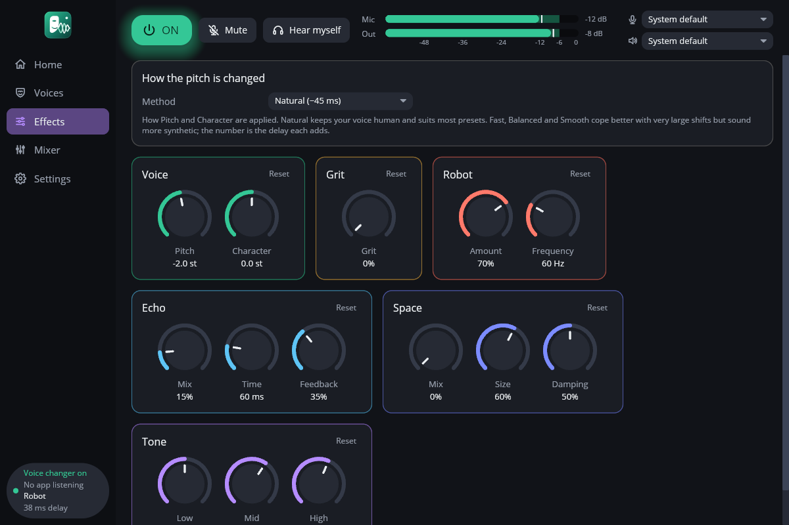
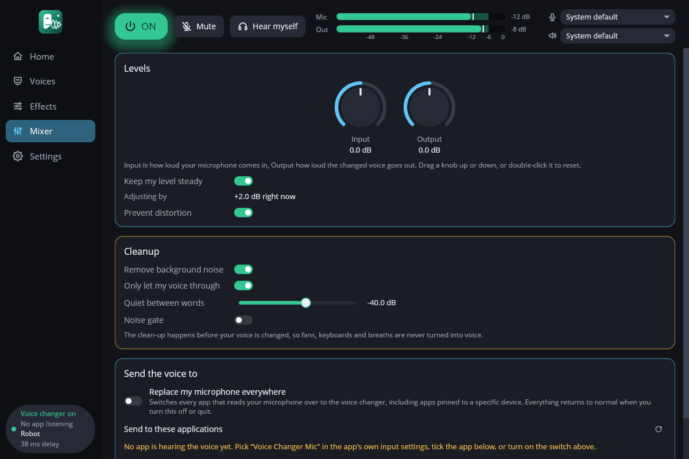
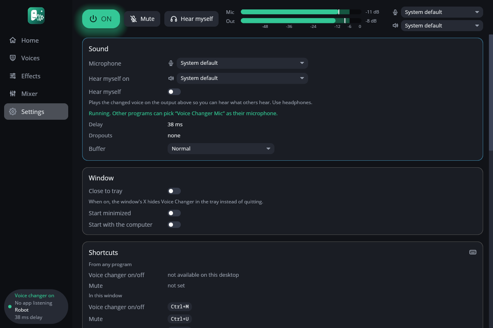

<p align="center">
  
</p>

<h1 align="center">Voice Changer</h1>

<p align="center">
  A realtime voice changer for Linux and Windows.
  Natural pitch shifting, effects, presets and local AI voices, with level meters, a mute button and nothing to configure.
  On Linux it shows up as a microphone called <b>Voice Changer Mic</b>; on Windows you pick an input and an output.
</p>

<p align="center">
  <a href="https://github.com/ZeroDay-Labz/voice-changer/releases/latest"></a>
  <a href="https://github.com/ZeroDay-Labz/voice-changer/actions/workflows/ci.yml"></a>
  <a href="https://github.com/ZeroDay-Labz/voice-changer/releases"></a>
  <a href="LICENSE"></a>
</p>

<p align="center">
  
</p>

## What is it?

Voice Changer sits between your microphone and everything else. It cleans the signal up
and changes the voice.

- **On Linux** the result is a new microphone, **Voice Changer Mic**. Any app that can pick
  a microphone can use it. There is nothing to configure in PulseAudio or JACK.
- **On Windows** you pick a microphone and an output device, and the changed voice plays on
  that output: headphones, a mixer, an audio interface. No virtual device is created and no
  sound setting is touched ([more](#windows)).

- **Sounds like a person.** The default **Natural** pitch engine is pitch-synchronous
  (the technique hardware voice transformers use), so shifted voices stay human instead of
  turning into a vocoder. Pitch and formant ("character") move independently.
- **Ready-made voices.** Man, Woman, Baritone, Bass, Deep, Demon, Monster, Chipmunk,
  Robot, Radio, Cave, Announcer. Star your favourites, save your own.
- **AI voices, locally.** Load any RVC v2 voice model and become that voice. Runs on the
  CPU or an AMD GPU, nothing leaves your machine. Retrieval indices are supported for a
  closer match.
- **Clean input.** Neural noise suppression (RNNoise) and a voice-only gate run before
  everything else, so fans, keyboards and breaths do not get turned into voice.
- **One big switch, and a mute.** ON/OFF and Mute in the window, in the tray, on global
  shortcuts, or from the terminal (`voice-changer toggle`, `voice-changer mute`). OFF passes
  your own voice through; Mute sends nothing: a cough button.
- **You can see what is going on.** Level meters for the microphone and the output with a
  scale, a zone to aim for and a clip warning; the delay, including the AI voice's, in the
  sidebar; problems explained in a sentence next to the button that fixes them.
- **Pick your devices.** Microphone and output in the top bar. A device that is unplugged
  is used again by itself when it comes back.
- **Hear myself.** One click plays the changed voice to the output you picked.
- **Your own presets.** Save, rename, update, share as a file, import.
- **Also a plugin.** The same engine and interface load as a **CLAP** plugin in your DAW.

<p align="center">
  
  
</p>
<p align="center">
  
  
</p>

## Install

| | |
|---|---|
| **Fedora, openSUSE, RHEL family** | Download the `.rpm` from the [latest release](https://github.com/ZeroDay-Labz/voice-changer/releases/latest), then `sudo dnf install ./voice-changer-*.rpm` |
| **Debian, Ubuntu, Mint, Zorin, Pop!_OS** | Download the `.deb`, then `sudo apt install ./voice-changer_*.deb` |
| **Arch, Manjaro, EndeavourOS** | `git clone` this repository, `cd packaging/aur`, `makepkg -si` |
| **Any Linux (also Steam Deck desktop mode)** | Download `VoiceChanger.flatpak`, then `flatpak install --user ./VoiceChanger.flatpak`; or unpack the `.tar.gz` and run `./voice-changer` (the CLAP plugin is in the same folder) |
| **Windows 10 and 11 (preview)** | Download `voice-changer-windows-x64.zip`, unpack it anywhere, start `voice-changer.exe`. Nothing is installed. See [Windows](#windows). |
| **From source** | See [Building](#building). `scripts/install.sh` builds and installs everything for your user. |

Every Linux asset comes for **x86_64** and **aarch64** (Raspberry Pi 5, Asahi Linux, ARM
laptops); the Windows build is x64. A `SHA256SUMS` file sits next to them.

AI voices run on the processor everywhere. AMD GPUs are used out of the box with the
`onnxruntime-rocm` package; NVIDIA GPUs after `voice-changer get-runtime --cuda` (see
[Compute](#compute-cpu-or-gpu)). `voice-changer doctor` tells you what your machine has
and what is missing.

The packages install the app, the CLAP plugin (`/usr/lib64/clap/` or `/usr/lib/clap/`), a
launcher and the icon. AI voice models are downloaded separately (see [AI voices](#ai-voices)).

### Requirements (Linux)

| | |
|---|---|
| Sound server | **PipeWire** with WirePlumber, as the *audio* server (not only for screen sharing). Tested with PipeWire 1.0 and 1.6. |
| System | glibc 2.35 or newer: Ubuntu 22.04+, Debian 12+, Fedora 36+, Linux Mint 21+, Zorin 17+, openSUSE Leap 15.6+ / Tumbleweed, Arch, NixOS |
| Desktop | Wayland or X11. Any GPU; virtual machines fall back to software rendering |
| Optional | A tray (KDE, GNOME with the AppIndicator extension), the GlobalShortcuts portal, `pipewire-pulse` so PulseAudio apps (Discord, browsers, OBS) see the microphone |

Ubuntu 22.04 and Debian 12 ship PulseAudio as the default sound server; install
`pipewire-audio` (Debian: `pipewire-audio` or `pipewire-pulse` + `wireplumber`), log out
and in, and you are set. **`voice-changer doctor`** tells you exactly what is missing
and what to install.

### Windows

The Windows version is a **preview**: it is built and tested automatically (including the
audio path, on Linux, and the AI engine, on Windows), but its author has no Windows machine
and has not run it on real sound hardware. Please [report](https://github.com/ZeroDay-Labz/voice-changer/issues) what you find.

- **No virtual audio cable, no driver.** Pick your microphone and an output in the top bar.
  The changed voice plays on that output. Nothing is installed; your sound settings are not
  touched; delete the folder to remove it.
- **Good for** a DJ or radio set-up, a podcast through a mixer or an audio interface,
  monitoring, recording the output of your interface.
- **Getting the voice into a call or a recording program** needs something that turns an
  output into an input: a mixer or interface with loopback, or a virtual cable you installed
  yourself. If you have one, it simply appears in the output list.
- The first start may show "Windows protected your PC" (the program is not signed): *More
  info*, then *Run anyway*.
- AI voices run on the processor. The graphics card (DirectML) can be picked under
  **Home → AI voice → More settings → Runs on** and is experimental: if it cannot run a
  voice the processor takes over, and it is left alone after a crash.
- `.pth` voices need Python 3 installed for the one-time conversion; `.onnx` voices do not.

## Using it

1. Start **Voice Changer** from your launcher (or run `voice-changer`). The **First steps**
   card walks you through the microphone, the output and a first voice.
2. Pick a preset on **Home**, or turn the quick-tweak knobs.
3. Linux: in Discord, OBS, your softphone, choose **Voice Changer Mic** as the input
   device. Windows: the voice is already playing on the output you picked.
4. Linux: press **Hear myself** to check how you sound. Use headphones.

| Where | What |
|---|---|
| **Top bar** | ON/OFF, Mute, Hear myself, the microphone and output meters, the microphone and output pickers |
| **Home** | Preset cards with search, favourites and an Edit mode (rename, share, delete, import), quick tweaks (Pitch, Character, Grit, Space, Echo), the AI voice card |
| **Voices** | Add AI voices from a link or a file, list and delete installed ones, download the base models, the test bench |
| **Effects** | How the pitch is changed, Voice, Grit, Robot, Echo, Space, Tone |
| **Mixer** | Input and output level, keep my level steady, prevent distortion, background noise removal, voice-only gate, noise gate; on Linux, where the voice is sent |
| **Settings** | Microphone, output, sound status, delay, dropouts and buffer size, window behaviour, every shortcut, AI threads and engine, theme and size, log |

Knobs: drag up or down, roll the mouse wheel, hold **Shift** for fine steps, double-click or
right-click to go back to the default. Sliders: drag or click anywhere on the rail, wheel,
and the same reset. Scrolling a page never changes a control the pointer passes over. Hover
any control for a moment and it explains itself.

**The meters.** Speak normally and the **Mic** bar should reach the shaded zone (−18 to
−6 dB). **CLIP** means it was too loud a moment ago: turn the microphone down. The **Out**
bar is what leaves the voice changer; it turns grey while the voice changer is off.

**Where the voice goes (Linux).** Any app can pick **Voice Changer Mic** in its own settings. The
Mixer page's *Send the voice to* section does it for you: **Use as the microphone for
everything** makes it the system default while the app runs (your previous default comes back
when you turn it off or quit), and the list below sends it to individual recording
applications, Discord, OBS, a browser tab, without touching anything else.

| Shortcut | Action |
|---|---|
| `Ctrl+M` or `Ctrl+Space` | Toggle on/off (window focused) |
| `Ctrl+U` | Mute |
| `Ctrl+H` | Hear myself |
| `Ctrl+1` … `Ctrl+5` | Home, Voices, Effects, Mixer, Settings |
| `Ctrl+,` | Settings |
| `Ctrl+F` | Search presets |
| `Ctrl+S` | Save the current settings as a preset |
| `Esc` | Cancel a save, rename or delete prompt; clear the search |
| `Ctrl+Q` | Quit |
| `Ctrl+Shift+M` | Global on/off, from any app |
| `Ctrl+Shift+U` | Global mute, from any app |

The global shortcuts go through the desktop portal on Linux (change them under Settings →
Shortcuts) and are registered directly on Windows. Settings → Shortcuts lists them all.

Closing the window quits and saves your state. Turn on **Close to tray** in Settings if you
would rather have it keep running in the tray.

### From the terminal

Everything the window does is also a command against the running instance:

```sh
voice-changer                      # window + tray + virtual mic
voice-changer toggle               # flip on/off (bind this to a key if the portal shortcut is unavailable)
voice-changer on | off | status
voice-changer mute                 # mute or unmute; `mute on`, `mute off`
voice-changer preset Robot         # apply a preset; `presets` lists them
voice-changer mics                 # list microphones; `mic <name>` switches, `mic default` resets
voice-changer outputs              # list outputs; `output <name>` switches, `output default` resets
voice-changer monitor on           # hear yourself; `monitor off`
voice-changer apps                 # who is recording and whether they get the voice
voice-changer route Discord on     # send the voice to an application; `route Discord off`
voice-changer default on           # be the default microphone for everything; `default off`
voice-changer ai "Nice Voice"      # switch on an AI voice; `ai off`; `ai-voices` lists them
voice-changer voices               # installed voice models
voice-changer voices add https://huggingface.co/user/voice-model "Nice Voice"
voice-changer voices remove "Nice Voice"
voice-changer show | quit
voice-changer doctor               # check this computer: PipeWire, session manager, mics, GPU, models, tray
voice-changer --self-test          # run the engine through every preset (no audio devices needed)
voice-changer --quantum 512        # bigger audio block if you hear dropouts (or Settings → Buffer)
voice-changer --ai-threads 4       # AI inference threads (default: auto, from your CPU)
voice-changer --help
```

## AI voices

Any **RVC v2** model works, which is the format almost every community voice comes in.

1. **Base models.** The Voices page offers a one-click download of ContentVec and RMVPE
   (MIT licensed, about 740 MB), or run `scripts/get-models.sh`.
2. **Add a voice.** Paste a voice-models.com voice page, a Hugging Face model page or a
   direct `.pth` / `.onnx` / `.zip` link into **Voices → Add a voice**, pick a file with
   **From a file…**, or drop the file on the window. `.pth` files are converted to ONNX automatically
   (the first conversion sets up a small Python environment, about 300 MB). A matching
   `.index` file is picked up when the repository or zip has one.
3. **Use it.** Press **Use** on the voice, or pick it on the Home page's AI card.

**Voices with more than one speaker.** Some models are trained on two takes, say a male and a
female version, selected by RVC's speaker id. RVC files do not record how many speakers a
model has, so on the Voices page set **Speakers** to 2 (or more) for that voice; a
**Speaker** picker then appears on the Home page, switching is instant, and **Starts as**
pins the speaker the voice always begins with. You can name the speakers ("Male",
"Female") right there. From the terminal: `voice-changer ai "Nice Voice" 2`.

Where to find voices: Hugging Face (search "RVC"), [voice-models.com](https://voice-models.com),
the AI Hub community. Check each model's licence and the voice owner's consent before using
a voice publicly. The app ships no voices.

Tips for the most natural result:

- **AI pitch** matters most. Set it so the converted voice lands in the model's natural
  range: +12 for a typical male→female model, 0 or −12 the other way. Leave the DSP
  **Pitch** at 0.
- **Breathiness** scales the model's noise excitation. Lower for a cleaner voice, higher
  for more texture.
- **Index strength** appears when the voice has a retrieval index. Around 75% keeps the
  model's timbre; lower if words become unclear.
- **AI only** (on by default) bypasses the DSP voice and effects while AI runs. Turn it off
  to layer Robot, reverb or extra pitch on top.
- Prefer models trained for 300+ epochs on an hour or more of clean speech, at 40k or 48k.
- **Protect consonants** (with an index) keeps breaths and consonants closer to what you
  said instead of pulling them toward the index. Raise it if s, t and sh sound smeared.
- **Follow my loudness** makes the converted voice as loud, moment by moment, as what you
  put in, so quiet breaths and mouth noises stay quiet and the noise gate works on the
  AI voice too.
- **Block coughs and burps** silences coughs, burps, sneezes, throat clearing and hiccups
  instead of converting them (laughter is left to the voice). It uses a small sound
  classifier, YAMNet (15 MB, Apache-2.0), fetched with the base models.
- **Settings belong to the voice.** Pitch, index, breathiness, protection and loudness
  are remembered per voice and come back when you select it.
- **Test bench** (Voices page): record a phrase once and replay it through any voice
  while you move the sliders. A replayed clip is heard through Hear myself only; the
  virtual microphone is silent while it plays.
- **Check** on a voice converts a test phrase and reports clipping, silence, poor pitch
  tracking or a missing index. New imports are checked automatically.
- **AI speed** (Auto) starts at the fastest setting and backs off to longer blocks if
  your machine falls behind. Expect about 0.5 s of delay on a GPU and 0.65 s on the
  processor; it needs a block of speech before it can convert it.

### Compute: CPU or GPU

**Compute** on the AI card picks Auto, CPU or a specific GPU; the models reload when you
change it. On the CPU expect about 60–80% of eight cores on a Ryzen 5950X for a 48 kHz
model. On an AMD GPU the content and pitch models run 4–5× faster and the voice sees a full
second of context per block, which keeps the timbre steadier.

The app loads ONNX Runtime at start and uses whichever it finds first:

| Runtime | Where it comes from | Result |
|---|---|---|
| ROCm build | Fedora: `sudo dnf install onnxruntime-rocm` (or `ORT_DYLIB_PATH`) | AMD GPUs appear under Compute |
| CUDA build | `voice-changer get-runtime --cuda` (needs only NVIDIA's driver) | NVIDIA GPUs appear under Compute |
| CPU build | bundled with the packages, `voice-changer get-runtime`, or the distribution's `onnxruntime` | CPU only |

Settings → AI shows which library is loaded. The first load of a voice on an AMD GPU
compiles kernels, which takes tens of seconds and is cached in `~/.cache/miopen`.

**Threads.** The AI picks its thread count from your processor: physical cores minus one
(so audio and the window always have a core), only the performance cores on hybrid
chips, at most 12, and just a few when the models run on a GPU. Settings → AI shows what
was detected and lets you choose a number up to the threads you have; `--ai-threads N`
does the same from the terminal. Lower it if other programs stutter while the AI runs.

**NVIDIA.** Nothing is needed for the app, the effects or AI voices on the processor.
To run the AI on the graphics card:

1. Install NVIDIA's driver so that `nvidia-smi` works (Fedora: RPM Fusion's
   `akmod-nvidia` and `xorg-x11-drv-nvidia-cuda`; Ubuntu: `nvidia-driver-5xx`;
   Arch: `nvidia-utils`). No CUDA toolkit is needed.
2. `voice-changer get-runtime --cuda` downloads Microsoft's CUDA build of ONNX Runtime
   and the NVIDIA libraries it needs (CUDA 12 and cuDNN 9) into
   `~/.local/lib/voice-changer/cuda`: up to 1.7 GB to download, up to 3 GB on disk, no
   root. Libraries the system already has are not downloaded again. It needs `curl`,
   `tar` and `unzip`.
3. `voice-changer doctor` says whether everything was found; then start the app and pick
   the GPU under Compute (Auto chooses it).

The CUDA 13 that current distributions package (Fedora 42 and later) cannot be used
instead: the runtime is built against CUDA 12, which is why the libraries are
downloaded. They are NVIDIA's own builds, from PyPI, checked against pinned checksums,
and stay under NVIDIA's licence. Delete `~/.local/lib/voice-changer/cuda` to remove
them. If a piece is missing the AI runs on the processor and Settings → AI says which
piece.
The same binary serves AMD, NVIDIA and CPU-only machines.

## Plugin

`cargo xtask bundle vc-plugin --release` writes `target/bundled/vc-plugin.clap`; the
packages install it system-wide and `scripts/install.sh` puts it in `~/.clap/`. The editor
is the same interface as the app, minus the microphone and window settings. VST3 can be
built with `--features vst3` (mind Steinberg's licensing terms).

## Latency

| Path | Added delay at 48 kHz, 256-frame block |
|---|---|
| Natural engine | ≈ 45 ms engine + one block (5 ms) |
| Fast / Balanced / Smooth | ≈ 20–60 ms depending on mode |
| Noise suppression | + 10 ms |
| AI voice | + 0.5–1 s (needs a block of speech to convert) |

The current figure, including the AI voice's delay while one is running, is shown in the
sidebar. Settings → Buffer → *Small* (or `--quantum 128`) shaves 2.7 ms if your interface
copes; USB headsets usually do not. On Windows add the two devices' own buffers, about
10 ms each in shared mode.

## Troubleshooting

Start with **`voice-changer doctor`**: it checks the sound server, the session manager,
virtual-device support, microphones, GPU and AI runtime, models, tray and shortcut
portal, and prints the fix for anything missing.

- **"Audio is not running" in the window.** PipeWire is not the sound server on this
  machine, or is not running. Ubuntu 22.04 / Debian 12: `sudo apt install pipewire-audio`
  (or `pipewire-pulse wireplumber`), log out and in. Elsewhere:
  `systemctl --user start pipewire wireplumber pipewire-pulse`. Press **Try again**.
- **The app looks right but there is no "Voice Changer Mic" in Discord or the browser.**
  Those apps talk PulseAudio; make sure `pipewire-pulse` is installed and
  `pactl info` says `Server Name: PulseAudio (on PipeWire …)`.
- **Blank, frozen or very slow window (VMs, some NVIDIA driver and Wayland combinations).**
  Run with `WGPU_BACKEND=gl voice-changer` (OpenGL instead of Vulkan) or
  `ICED_BACKEND=tiny-skia voice-changer` (software rendering). The audio side is not
  affected by either.
- **The app closes when an AI voice is picked** (0.3.1 and older, on machines without an
  AMD GPU). Fixed in 0.4.0; update.
- **No window and no tray icon.** GNOME needs the AppIndicator extension for a tray; the
  app opens its window instead when "Start minimized" finds no tray. `voice-changer show`
  always brings it up.
- **Pops or crackle.** Check the sidebar for "dropouts". Pick a larger **Buffer** under
  Settings → Sound and start Voice Changer again. On Linux, `pw-top` while speaking shows
  whether PipeWire itself is dropping (`ERR` rising on your microphone or on
  `voice_changer.*` nodes).
- **Windows: no sound from the microphone.** Settings → Privacy & security → Microphone:
  allow desktop apps to use it. Then check the microphone picker in the top bar.
- **Windows: the meters move but I hear nothing.** Pick the output you are listening on in
  the top bar (the speaker icon), and check that Mute is not red.
- **Words get cut.** Turn off **Only let my voice through** in Mixer, or raise **Quiet
  between words** (e.g. −20 dB) so more passes between words.
- **No "Voice Changer Mic" in an app.** The node exists only while the app runs. Flatpak
  apps need PipeWire access (`--filesystem=xdg-run/pipewire-0`).
- **The app runs, the meters move, but nobody hears the changed voice.** The other app is
  still using your real microphone. Either pick **Voice Changer Mic** in that app's own input
  settings, tick the app under Mixer → *Send the voice to*, or turn on *Use as the microphone
  for everything* and leave the app on "Default". `wpctl status` shows which source each
  recording stream is linked to.
- **Changed voice is very quiet.** Older session managers remembered a low volume for the
  virtual mic. Since 0.2.2 the app holds it at 100% itself; on older versions run
  `wpctl set-volume <id of Voice Changer Mic> 1.0`.
- **Importing a `.pth` fails with "No module named …".** Update to 0.2.1 or later; the
  converter environment repairs itself on the next import.
- **Global shortcut does nothing.** Your desktop may lack the GlobalShortcuts portal. Bind
  `voice-changer toggle` to a key in System Settings → Shortcuts → Custom instead.
- **AI "error" or "loading" forever.** Settings → Log shows why. Common causes: base models
  missing (Voices page), a v1 model (256-dim) instead of v2, or a GPU runtime that is not
  installed (`sudo dnf install onnxruntime-rocm`).
- **Test without talking.** `voice-changer --input-wav speech.wav --monitor` loops a file as
  the microphone.

## Where your stuff is kept

On Windows everything is under `%APPDATA%\echo\voice-changer\` (`config` and `data`);
the table below is for Linux.

| | |
|---|---|
| Settings and last state | `~/.config/voice-changer/config.ron`, `state.ron` |
| Launcher and icons (written on first start unless a package installed them) | `~/.local/share/applications/`, `~/.local/share/icons/hicolor/` |
| CPU ONNX Runtime (when fetched by the install script) | `~/.local/lib/voice-changer/` |
| Your presets and favourites | `~/.config/voice-changer/presets/*.ron`, `favorites.txt` |
| Base models and voices | `~/.local/share/voice-changer/models/`, `models/voices/` |
| Converter environment | `~/.local/share/voice-changer/tools/` |

**Open data folder** on the Settings page takes you there.

## Building

```sh
# Fedora
sudo dnf install pipewire-devel clang gcc-c++ libxkbcommon-devel wayland-devel
# Debian / Ubuntu
sudo apt install libpipewire-0.3-dev libclang-dev pkg-config libxkbcommon-dev libwayland-dev build-essential

git clone https://github.com/ZeroDay-Labz/voice-changer && cd voice-changer
scripts/install.sh              # app + CLAP plugin + launcher into ~/.local (GPU-capable)
scripts/install.sh --cpu-only   # without the dynamic runtime loader
cargo run                       # or just run it from the tree
```

On Windows: Rust with the MSVC toolchain, then `cargo build --release -p vc-app -p vc-plugin`
and `scripts\package-windows.ps1` (fetches the AI engine and assembles the folder).
`cargo build -p vc-app --features backend-cpal` builds the Windows audio path on Linux,
which is how it is tested (`scripts/ci/smoke-devices.sh`).

Rust 1.88 or newer. `cargo test --workspace` runs the DSP and index tests;
`cargo clippy --workspace --all-targets` must stay clean. See [CONTRIBUTING.md](CONTRIBUTING.md).

| Crate | Purpose |
|---|---|
| `vc-dsp` | Realtime-safe engine (no allocation or locks in `process`) |
| `vc-core` | Parameters, presets, pipeline, AI inference and voice library |
| `vc-gui` | iced interface shared by the app and the plugin |
| `vc-app` | Standalone: audio (PipeWire virtual mic on Linux, input and output devices on Windows), window, tray, hotkeys, remote control, CLI |
| `vc-plugin` | CLAP (and optional VST3) plugin via nice-plug |

## Notes

- Mono, 48 kHz internally; multichannel plugin inputs are folded to mono and fanned out.
- On Linux the D-Bus interface is `org.voicechanger.Control` on the session bus and the
  CLI is a thin client for it. On Windows the CLI talks to the running program over a
  named pipe.
- ONNX Runtime upstream dropped its ROCm build; the app loads the distribution's
  `onnxruntime-rocm` library at runtime instead, and Microsoft's CUDA build for NVIDIA.
- Screenshots in this README are rendered by the app itself:
  `voice-changer --screenshot docs/screenshots/home.png --page home`.
- `voice-changer --ai-self-test` loads the AI engine and runs a tiny built-in model on the
  processor and on the graphics card, without needing a voice.

## License

MIT. See [LICENSE](LICENSE). Voice models you download have their own licences.
